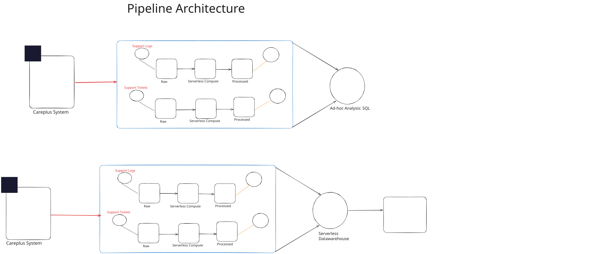

# CarePlus Ticket Insights

### Automated AWS Data Pipeline | Amazon Redshift | Power BI

CarePlus Ticket Insights is an end-to-end data engineering and business intelligence project that transforms customer-support tickets and application logs into analytics-ready datasets for centralized analysis and interactive reporting.

Built using AWS services, Python, SQL, and Power BI, the project demonstrates data ingestion, event-driven ETL orchestration, data transformation, warehouse loading, analytical modeling, and dashboard development.

**Explore the live dashboard:** [CarePlus Ticket Insights — Power BI](https://app.powerbi.com/view?r=eyJrIjoiOTFkODE1MDAtZTEwMS00OTliLTgzZGEtNmZhNGQ5NzY2YWUxIiwidCI6ImM2ZTU0OWIzLTVmNDUtNDAzMi1hYWU5LWQ0MjQ0ZGM1YjJjNCJ9)

---

## Project Overview

Support and operations teams need a consistent view of ticket demand, service performance, agent workload, and application health. When ticket records and application logs are processed separately, producing consistent reports and connecting operational trends becomes more difficult.

CarePlus Ticket Insights brings these data sources into a common analytics workflow. Source data is ingested into Amazon S3, transformed into structured datasets, prepared for warehouse analysis, and presented through Power BI reports.

The project focuses on two complementary areas:

- **Support analytics:** Ticket volume, ticket status, channel distribution, resolution time, and agent workload.
- **Operational analytics:** Application events, error signals, response time, CPU utilization, and user-agent activity.

## Key Contributions

- **Automated ETL orchestration:** Integrated Amazon S3 events, AWS Lambda, and AWS Glue to initiate ticket-data transformation workflows.
- **Data ingestion:** Developed Python-based workflows for extracting support-ticket records and collecting daily application logs.
- **Data transformation:** Implemented cleaning, parsing, standardization, duplicate removal, and data-type conversion for structured datasets.
- **Analytics-ready storage:** Organized raw and processed data in Amazon S3 and used Parquet for curated datasets.
- **Cloud data warehousing:** Designed Amazon Redshift tables and loading workflows for centralized analytical queries.
- **SQL analytics:** Developed Athena and Redshift queries to investigate support demand and application behavior.
- **Business intelligence:** Built a Power BI report and semantic model with DAX measures for interactive operational reporting.

## Business Challenge

Support leaders need reliable visibility into ticket volume, ticket status, agent workload, and application performance. Data spread across operational databases, daily log files, and separate analytical workflows can make reporting fragmented and difficult to maintain.

The project addresses this challenge by organizing support and log data into a repeatable pipeline and presenting the resulting information through a unified reporting experience.

## Solution Architecture

<p align="center">
  
</p>

### End-to-End Data Flow

1. **Ingest source data:** Extract support-ticket records from the operational database and collect application-log files.
2. **Store raw data:** Upload source data to designated Amazon S3 raw-data locations.
3. **Trigger processing:** Use Amazon S3 event notifications and AWS Lambda to initiate the relevant processing workflow.
4. **Transform datasets:** Use AWS Glue and Python-based processing to clean, standardize, and transform source data.
5. **Publish curated data:** Store processed datasets in Parquet format in the S3 processed-data locations.
6. **Load warehouse tables:** Use the project's Redshift loading workflows and SQL `COPY` operations to load curated data.
7. **Query and analyze:** Use Amazon Redshift for warehouse analytics and Amazon Athena for SQL analysis of data in S3.
8. **Visualize results:** Connect Power BI to the analytical data layer and present metrics through interactive reports.

AWS IAM roles and service permissions support access between the relevant AWS components.

## Live Dashboard

Explore the interactive Power BI report:

**[Open the CarePlus Ticket Insights Dashboard](https://app.powerbi.com/view?r=eyJrIjoiOTFkODE1MDAtZTEwMS00OTliLTgzZGEtNmZhNGQ5NzY2YWUxIiwidCI6ImM2ZTU0OWIzLTVmNDUtNDAzMi1hYWU5LWQ0MjQ0ZGM1YjJjNCJ9)**

### Support Tickets Dashboard

<p align="center">
  
</p>

This report supports analysis of ticket volume, status distribution, channel mix, and support performance.

### Support Logs Dashboard

<p align="center">
  
</p>

This report supports analysis of log activity, error signals, response time, CPU utilization, and application behavior.

## Data Model and Analytical Measures

The Power BI semantic model brings together support-ticket and application-log data using shared ticket and date dimensions.

| Table | Purpose | Example attributes |
|---|---|---|
| `support_tickets` | Support case activity | Ticket ID, creation and resolution timestamps, agent, priority, channel, status, category, interactions |
| `support_logs` | Application and operational events | Timestamp, component, log level, ticket/session IDs, response time, CPU, error flag, user agent |
| `dim_tickets` | Shared ticket identifier | Ticket ID |
| `dim_date` | Consistent date analysis | Date, year, month, day, weekday |

The model includes measures for total, resolved, open, and escalated tickets; average resolution time; average interactions; active agents; total log events; distinct tickets represented in logs; average CPU utilization; and average response time.

Actual metric values depend on the loaded data and the definitions implemented in the semantic model.

## Example Analytical Questions

The project's SQL and reporting layers are designed to explore questions such as:

- Which communication channels receive the most support tickets?
- What proportion of tickets are resolved, open, or escalated?
- How does ticket creation volume change over time?
- Which user agents generate the most application events?
- How many events are recorded at the DEBUG level?
- How does average CPU utilization vary by user agent?
- What patterns appear in response times and application errors?

These analyses can help support teams investigate operational trends and identify areas for further review.

## Technology Stack

| Area | Technologies |
|---|---|
| Programming | Python, SQL |
| Data ingestion | Python notebooks, database extraction, file-based log ingestion |
| Workflow orchestration | Amazon S3 event notifications, AWS Lambda, AWS Glue |
| Data transformation | AWS Glue, PySpark, Python, pandas |
| Data lake | Amazon S3, raw and processed data zones |
| File format | Apache Parquet |
| Data warehouse | Amazon Redshift Serverless |
| Query engine | Amazon Athena |
| Business intelligence | Power BI, DAX, semantic modeling, `.pbip` |
| Security and configuration | AWS IAM, environment-based configuration |

## Repository Structure

```text
.
├── data-ingestion/
│   ├── support-tickets/
│   ├── support-logs/
│   └── meta_data.txt
├── data-transformation/
│   ├── support-tickets-transformation/
│   └── support-log-transformation/
├── data-warehousing-analytics/
│   ├── redshift-setup/
│   └── athena-sql-queries/
├── careplus ticket insight.SemanticModel/
├── careplus ticket insight.Report/
├── screenshots/
├── aws_project_pipeline.svg
└── README.md
```

Refer to the repository for the complete set of notebooks, SQL scripts, report assets, and configuration files.

## Getting Started

### Prerequisites

- An AWS account with appropriate service permissions.
- Python and Jupyter Notebook.
- An operational database containing support-ticket data, or an equivalent approved source.
- An Amazon S3 bucket.
- AWS Glue and AWS Lambda configured for the relevant processing workflows.
- Amazon Athena configured to query the required S3 data.
- Amazon Redshift Serverless with the required database objects and access permissions.
- Power BI Desktop for inspecting or modifying the report.

### Setup and Configuration

1. **Clone the repository.**

   ```bash
   git clone https://github.com/PrashantDes/careplus-ticket-insights.git
   cd careplus-ticket-insights
   ```

2. **Configure the environment.** Copy the root `.env.example` file to `.env` and populate the required values. The `.env` file is excluded from Git; never commit credentials.

3. **Configure AWS access.** Set up an AWS profile or execution role with the required permissions for S3, Lambda, Glue, and the other services used by the workflow.

4. **Update resource references.** Replace placeholder bucket names, AWS account identifiers, IAM role ARNs, database settings, and regional settings in notebooks and SQL scripts.

5. **Run ingestion workflows.** Configure the source connection and ingest support-ticket records and application logs into the appropriate S3 raw-data locations.

6. **Configure automated processing.** Set up the relevant Lambda functions, S3 event notifications, Glue jobs, and job arguments. Ensure that the argument names used by Lambda match those expected by each Glue job.

7. **Transform the data.** Run the transformation workflows and verify that the processed datasets are written to the expected S3 prefixes.

8. **Set up the warehouse.** Execute the Redshift DDL scripts, configure the appropriate IAM role for S3 access, and run the loading workflows.

9. **Configure analytics.** Run the Athena SQL queries and validate the results against the source and processed datasets.

10. **Open the Power BI project.** Open the `.pbip` project in Power BI Desktop, configure the warehouse connection and credentials, and refresh the semantic model.

Exact setup requirements depend on the AWS resources, data sources, and configuration used in your environment.

## Data Quality and Reliability

The transformation workflows include data-cleaning and standardization operations. For reliable analytical results, the pipeline should also be validated for:

- Missing or malformed fields.
- Invalid timestamps and numeric values.
- Unexpected ticket statuses or log levels.
- Differences between source and processed record counts.
- Duplicate records after retries or repeated event delivery.
- Failed transformation jobs and unsuccessful warehouse loads.
- Consistency between warehouse query results and Power BI measures.

The presence of these validation steps should be confirmed in the deployed workflow before treating the pipeline as production-ready.

## Security and Privacy

- Do not commit AWS credentials, access keys, database passwords, or other secrets.
- Keep local environment files and sensitive operational data out of version control. The `.gitignore` excludes `.env` files (except `.env.example`), notebook checkpoints, local Power BI state, raw log samples, and generated Parquet files.
- The local support database seed file at `data-ingestion/support-tickets/careplus_support_db.sql` is intentionally excluded from Git. Use an approved database or synthetic data when setting up the project.
- Use IAM roles and least-privilege permissions where possible.
- Replace infrastructure placeholders before execution.
- Use approved, anonymized, or synthetic data for portfolio demonstrations.
- Review published dashboard access settings before sharing the report publicly.

## Future Improvements

- Replace local date tracking with durable, restart-safe ingestion state.
- Handle empty source dates without blocking subsequent ingestion.
- Make processing idempotent to safely handle retries and duplicate S3 events.
- Implement staging and deduplication strategies for reliable incremental Redshift loading.
- Add automated schema and data-quality validation.
- Add monitoring, structured error logging, and failure notifications.
- Create repeatable deployment instructions and automated tests.
- Document verified execution results and measurable analytical findings.

## Skills Demonstrated

- Cloud data engineering with AWS.
- Python-based data ingestion and transformation.
- Event-driven ETL orchestration.
- Data lake design and Parquet-based storage.
- SQL analytics and cloud data warehousing.
- Analytical data modeling and DAX measures.
- Power BI report development.
- Data quality, security, and pipeline reliability considerations.

## Author

**Prashant Lodhi**

---

*CarePlus Ticket Insights is a portfolio project demonstrating an end-to-end support analytics workflow. Infrastructure identifiers are environment-specific placeholders, and deployment, reliability, and business outcomes should be validated in the target environment.*
